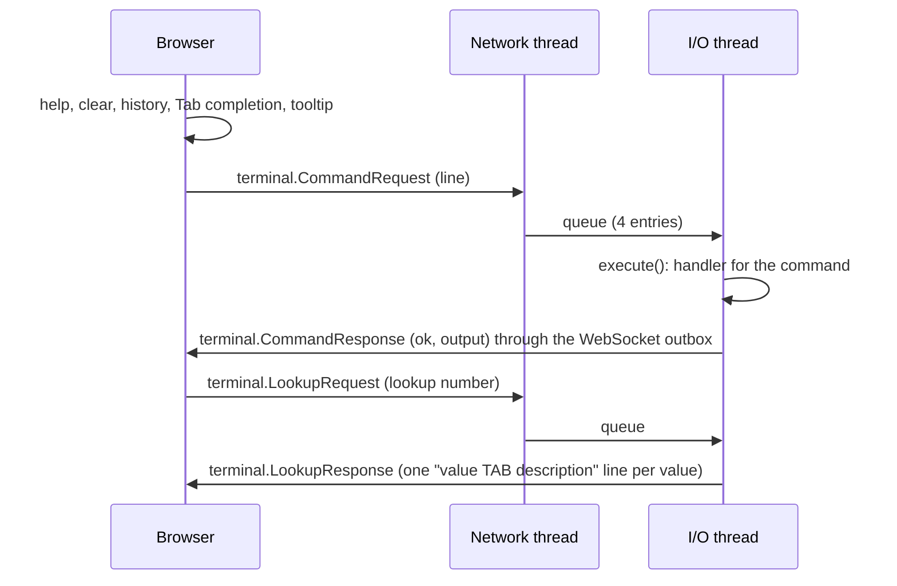

# Terminal page

The web UI page "Terminal" has two parts: a console for test commands close to the hardware, and the live firmware log as a table. This document covers the console. The framework (schema syntax, `execute()`, handlers, helpers) is described in [rtoos/docs/terminal.md](../rtoos/docs/terminal.md).

## Files

| file | role |
|---|---|
| [schema/terminal/commands.cs](../schema/terminal/commands.cs) | the catalog: commands, parameters, values, lookups (C# classes) |
| [schema/best_binary_buffers/terminal.cs](../schema/best_binary_buffers/terminal.cs) | the WebSocket messages: `CommandRequest`/`CommandResponse`, `LookupRequest`/`LookupResponse` |
| `generated/terminal_commands.hh`, `web/generated/terminal-commands.ts` | generated by `dotnet run --project builder -- GenerateTerminalFiles` (`TerminalCatalog` in `dotnet_libs/firmware_builder_common`) |
| [src/web.cpp](../src/web.cpp) | receives the requests (network thread), hands them to the terminal |
| [src/terminal.cpp](../src/terminal.cpp) | the FCU's command handlers and lookup answers, the queue to the I/O thread |
| [web/src/apps/terminal-app.ts](../web/src/apps/terminal-app.ts), [web/src/terminal/command-line.ts](../web/src/terminal/command-line.ts) | the console in the browser |

## What happens where

- The browser does everything except running a command: `help` and `clear` (client commands), history (arrow up/down), completion of commands and parameter values (Tab), the parameter tooltip. The catalog is compiled into the web app.
- The I/O thread runs the commands, because it owns the pins and buses. A command runs in its next cycle and delays that cycle while it runs.
- Lookup values are fetched when needed and kept for 1 s in the browser.

## Limits

| limit | value | where |
|---|---|---|
| command line | 200 characters (more is cut off) | `CommandRequest.line`, `Request` in `terminal.cpp` |
| words per line | 8: the command and up to 7 arguments; more is an error | `rtos::terminal::max_words` |
| output of a command or lookup | about 1,100 characters (more is cut off) | `CommandResponse.output`, `LookupResponse.values` |
| queue | 4 requests; a fifth is dropped with a log warning | `requests` in `terminal.cpp` |

## Adding a command

1. Add a class with `[TerminalCommand]` to `schema/terminal/commands.cs`: the `///` summary is the help text, the fields are the parameters (`string?` = optional), `[Value]`/`[Lookup]`/`[Source]` give their values.
2. Run `dotnet run --project builder -- GenerateTerminalFiles`.
3. In `src/terminal.cpp`, write `bool cmd_<name>(Args a, Out& o)`: check the arguments (return `false` for wrong ones, the usage line is added), write the output with `o.line(...)`.
4. Add it to `handlers`. A missing handler does not compile.
5. Build the firmware and the web app (`npm run build` in `web/`).

A new lookup: a member of `enum Lookup` in `commands.cs`, `[Lookup(Lookup.<name>)]` at the parameter, a `case` in `lookup()` in `terminal.cpp` (a missing one is a `-Wswitch` error).

## Commands

`info`, `in`, `out`, `pwm`, `gpio`, `adc`, `power`, `temp`, `sensors`, `i2c`, `reg`, `stepper`, `home`, `led`, `reset`; in the browser `help` and `clear`. `help` lists them with their usage; `help <command>` shows the parameters and their values.
